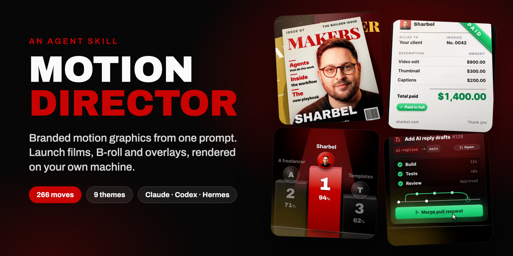
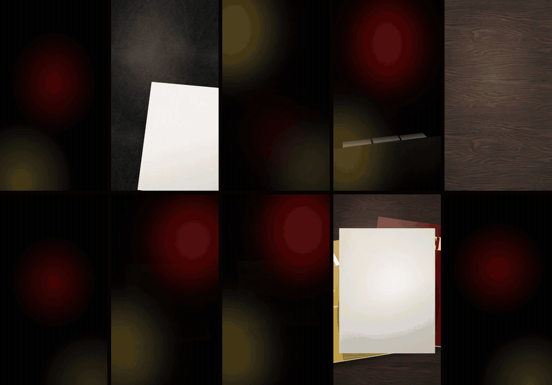
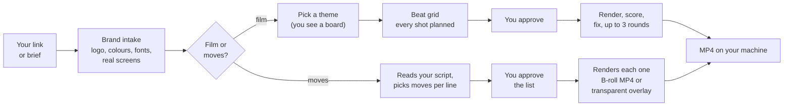
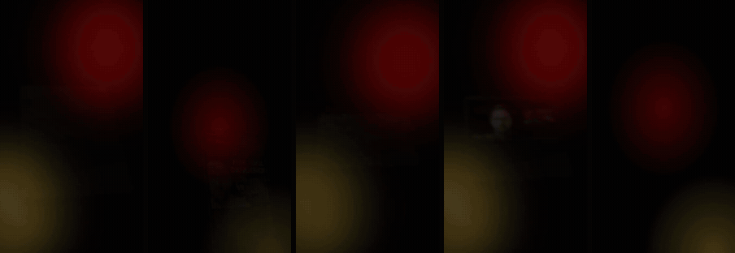
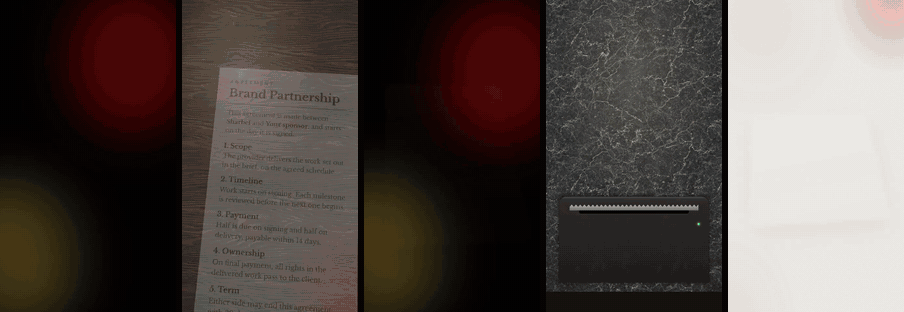
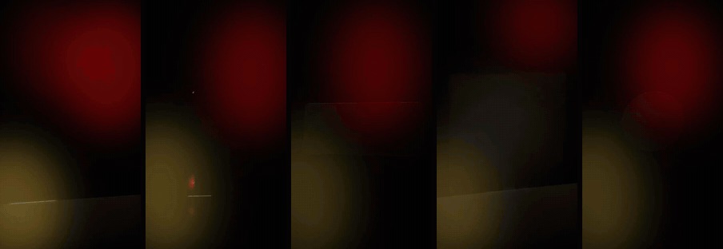
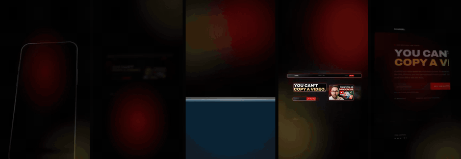

<p align="center"></p>

# Motion Director

An agent skill that makes branded motion graphics for you. Give your AI agent a link or a
sentence, and it renders a finished MP4 on your own machine, in your brand's colours, fonts,
logo and real product screens.

Two things it does:

- **Films.** A 10 to 30 second launch video, product demo, channel intro or explainer.
- **Moves.** Single graphics for videos you filmed: B-roll cutaways, and transparent overlays
  that sit on top of your talking head. 266 of them, from a post card to a pull request to a
  bar race.

Works with **Claude Code**, **Codex** and **Hermes Agent**, and any agent that reads `SKILL.md`
skill folders. No accounts, no API keys, no stock music, nothing uploaded.

<p align="center"></p>

## Install

macOS or Linux, one line. It finds the agents you have and installs into each:

```sh
curl -fsSL https://raw.githubusercontent.com/sharbelxyz/motion-director/main/install.sh | bash
```

Then open your agent and say **"set up motion director"**. That's it.

<details>
<summary>Install by hand, or for one agent only</summary>

```sh
git clone https://github.com/sharbelxyz/motion-director
cd motion-director
./install.sh --claude      # Claude Code   -> ~/.claude/skills/motion-director
./install.sh --codex       # Codex         -> ~/.codex/skills/motion-director
./install.sh --hermes      # Hermes Agent  -> ~/.hermes/skills/creative/motion-director
./install.sh --dir <path>  # any other agent's skills folder
```

Hermes can also install it straight from GitHub:

```sh
hermes skills install https://github.com/sharbelxyz/motion-director
```

Windows: install [Node.js 22+](https://nodejs.org) and [FFmpeg](https://ffmpeg.org), then copy
`skills/motion-director` into your agent's skills folder (for Claude Code,
`%USERPROFILE%\.claude\skills\`).

To update, run the installer again. Your old copy is moved to `~/motion-director/backups`,
never deleted.
</details>

## First run

Say **"set up motion director"** (or just ask for your first video). The agent walks you through it:

1. Checks your machine and fetches what's missing (Node 22+, FFmpeg, and the
   [HyperFrames](https://github.com/heygen-com/hyperframes) renderer with its headless Chrome).
2. Asks for your website, your editor (Premiere, Final Cut, Resolve, CapCut) and the format
   you post most (9:16, 16:9, 1:1).
3. Learns your brand from the site: logo, colours, fonts and real product screenshots.
4. Renders a first graphic in your brand so you can see it working.
5. Saves your defaults, so after this you just ask.

## Things to say

Copy any of these into your agent:

```text
Make a 20 second launch video for https://yoursite.com, 9:16.
```
```text
Here is my script: <paste it>. Pick B-roll and overlays for it and give me the list.
```
```text
Give me a transparent overlay for when I say "we hit 10,000 sign-ups".
```
```text
Show me the gallery of moves.
```
```text
Make a channel intro for https://youtube.com/@yourchannel.
```
```text
Copy the style of this video for my brand: <link>.
```
```text
Add this to the library: <link to a motion graphic you like>.
```

## How it works



- **Your brand, captured once.** A headless browser reads your site and keeps the brand in
  `~/motion-director/brands`, reused every time.
- **Nothing animates until you say yes.** Films get a shot-by-shot plan, moves get a placement
  list (time, move, words), and the agent waits.
- **It checks its own work.** Every render is audited frame by frame for cut text, overlaps and
  anything off the edge, then looked at before you see it.
- **Overlays come out transparent.** ProRes 4444 `.mov` for Premiere, Final Cut and Resolve, or a
  green-screen MP4 for CapCut.
- **Cheap to run.** Choosing moves reads a short index and one category file, about 2k tokens,
  never the whole library.

## The library

266 moves in ten groups. Every one renders in 9:16, 16:9 and 1:1, in any brand.

**Creator and social**: analytics, stories, captions, subscribes, comment keywords



**AI and dev**: agent runs, tool hubs, deploys, code diffs, image grids


**Business and paper**: pricing, contracts, carts, receipts, deal pipelines



**Data**: races, crossovers, maps, treemaps, radar charts



**System and explainers**: lock screens, shortcuts, icebergs, exploded views, permissions



Plus nine whole-film themes (glass, glass folder, studio, product UI, logo build, monochrome,
retro print, puppet collage, safari collage). Open `skills/motion-director/gallery.html` in a
browser to see every move looping, filtered by use and look.

The previews are shown in an example brand (mine). Your renders use yours.

## Needs

| | |
|---|---|
| Node.js 22+ | runs the renderer and every script (no npm dependencies) |
| FFmpeg | encoding and frame checks |
| HyperFrames 0.8.188 | fetched on first run, through npx, nothing installed globally |
| ~2 GB free disk | for the renderer's Chrome and your projects |

## Privacy

Everything renders locally. HyperFrames runs with telemetry off and with any cloud AI keys
removed from its environment. Set `MD_ALLOW_CLOUD=1` if you want its paid AI features.

## Licence

MIT. Fonts and textures bundled with the moves are CC0, OFL or Apache, listed in each move's
`credits.json`. Soundtracks are synthesised fresh for every film. Brand logos, fonts and
screenshots the skill captures belong to their owners: it captures them so you can make videos
for that brand, not to redistribute them.

Made by [Sharbel](https://sharbel.com).
